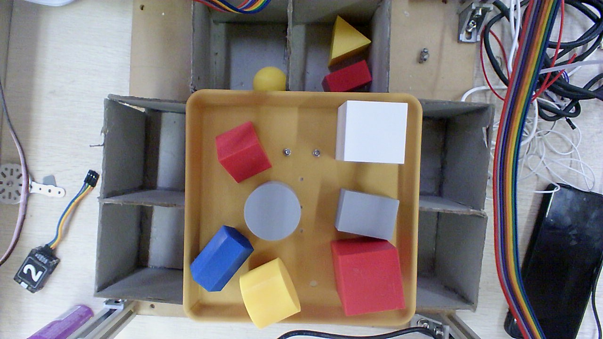
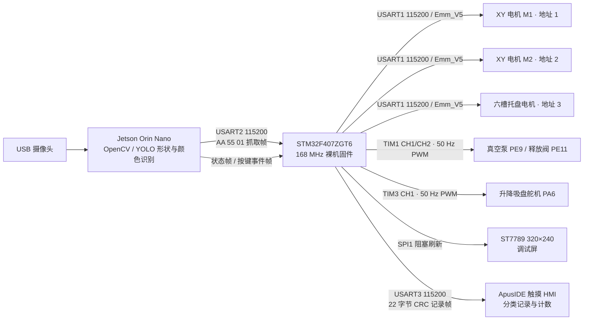
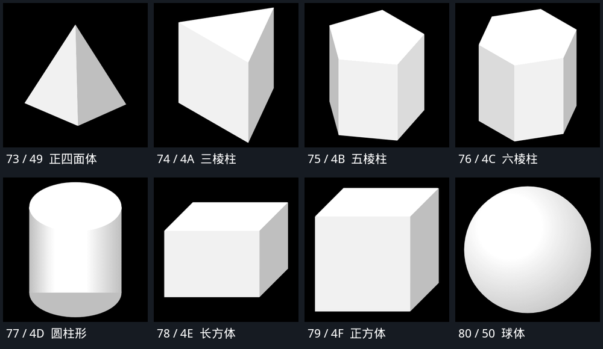
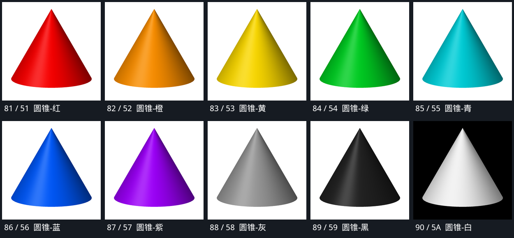

# HUATAI · 2026 工创赛智能分拣系统

[](LICENSE)
[](#硬件组成)
[](#视觉上位机)

基于 **STM32F407ZGT6 + Jetson Orin Nano + ApusIDE HMI** 的桌面级智能分拣工作站，面向 2026 年工创赛智能分拣赛项。

摄像头俯视取料区，Jetson 识别工件的几何形状与颜色，通过 USART2 把目标坐标和 1..90 指令码下发给 STM32；STM32 完成 **CoreXY 双电机定位 → 六槽旋转托盘选槽 → 真空吸取 → 固定点释放 → 回停靠点** 的完整动作链，并把分类记录推送到触摸 HMI。系统同时提供 ST7789 调试屏、实体按键启动和 4800 bps 软件串口 DEBUG Shell。



---

## 目录

- [系统架构](#系统架构)
- [功能特性](#功能特性)
- [硬件组成](#硬件组成)
- [仓库结构](#仓库结构)
- [快速开始](#快速开始)
  - [1. 编译与烧录固件](#1-编译与烧录固件)
  - [2. 运行 Jetson 视觉上位机](#2-运行-jetson-视觉上位机)
  - [3. 部署 ApusIDE HMI](#3-部署-apuside-hmi)
  - [4. 离线测试](#4-离线测试)
- [一次完整分拣流程](#一次完整分拣流程)
- [通信协议](#通信协议)
- [调试与模式选择](#调试与模式选择)
- [设计约束与已知限制](#设计约束与已知限制)
- [文档索引](#文档索引)
- [许可证](#许可证)

---

## 系统架构



三层职责划分：

| 层 | 运行平台 | 职责 |
|---|---|---|
| 视觉层 | Jetson Orin Nano | 相机采集、颜色分割/形状识别、像素坐标到机械坐标的标定、目标稳定性判定、串口任务下发与重试 |
| 实时控制层 | STM32F407ZGT6 | CoreXY 运动学、电机事务总线、托盘相位、真空与升降时序、任务去重、超时保护、调试屏 |
| 交互层 | ApusIDE HMI | 90 类形状×颜色记录、固件分配的分类 ID、同类计数、会话清空 |

---

## 功能特性

- **视觉引导抓取**：Jetson 输出目标毫米坐标与形状×颜色指令码，STM32 不再做视觉判断。
- **CoreXY 双电机同步**：正解/逆解 `P1=(X+Y)×80`、`P2=(X−Y)×80`（pulse/mm），行程 `X=0..215 mm`、`Y=0..205 mm`。
- **六槽旋转托盘**：分类 ID 1..6 对应 0°/60°/120°/180°/240°/300°，固定单方向累计角度定位，不抄近路。
- **首次出现分配 ID**：同一形状×颜色始终复用原 ID；第七个新类循环回 ID1，旧类映射保留。
- **真空吸取与释放**：TIM1 双通道分别控制泵与释放阀；吸取保持 1500 ms，释放泄压 2000 ms。圆柱系列使用独立的 130° 取料下降高度。
- **释放后记录**：机械释放成功后向 HMI 发送一条带固件 ID 的 22 字节 CRC 记录帧；停靠失败仍上报 `FAILED`，但不重复记录。
- **任务去重**：以 `(SEQ, CMD, X_raw, Y_raw)` 为键。执行中的重复帧回 `BUSY`，已完成任务的重复帧补发上次结果，不重复转动、吸取或记录。
- **24 秒任务预算**：超时立即停止 XY/托盘并使软件原点失效，等待人工排查，不自动清零。
- **双模式启动**：上电 3 秒窗口内按 PE2 进入 DEBUG，否则进入 HOST；模式锁定至复位。
- **DEBUG Shell**：PF2/PF4 软件串口，4800 8N1，支持 `move`、`tray`、`lift`、`vacuum`、`hmi`、`zero`、`status` 等命令。
- **离线回归**：机械运动、串口协议、HMI 收包线程、按键逻辑、ROI 与 HMI 资源均有 Python 回归脚本。

---

## 硬件组成

| 模块 | 型号 / 接口 | 关键参数 |
|---|---|---|
| 主控 | STM32F407ZGT6 | 168 MHz，HSI→PLL，HAL 裸机，无 RTOS |
| XY 平台 | 2× Emm_V5 步进驱动 | USART1 地址 1/2，115200 8N1，2GT 皮带 / 20 齿 / 16 细分 = 80 pulse/mm |
| 旋转托盘 | Emm_V5 步进驱动 | USART1 地址 3，3200 pulse/rev，65536 反馈单位/rev，60°/槽 |
| 真空机构 | TIM1_CH1 / TIM1_CH2 | PE9 泵、PE11 阀，1 µs/tick、50 Hz PWM |
| 升降吸盘 | TIM3_CH1 | PA6 舵机，50 Hz；抬升 270°、普通下降 100°、圆柱取料 130°、释放 200° |
| 调试屏 | ST7789 320×240 | SPI1：PA5=SCK、PA7=MOSI、PF12=DC、PB12=BLK、PB13=CS、PB15=RST，阻塞刷新 |
| 触摸 HMI | ApusIDE 串口屏 | USART3：PB10=TX、PB11=RX，115200 8N1 |
| 视觉主机 | Jetson Orin Nano | 40 Pin UART1：Pin 8=TX、Pin 10=RX，`/dev/ttyTHS1`，115200 8N1 |
| 启动按键 | PE2 | 内部上拉、低电平有效，5 ms 采样 / 20 ms 消抖 |
| 状态 LED | PF9=LED0、PF10=LED1 | 低电平点亮；HOST 亮 LED0，DEBUG 亮 LED1 |
| 调试 Shell | PF2=TX、PF4=RX | 3.3 V TTL 软件串口，4800 8N1，TIM13 8 倍采样 |

> 接线、电平与机械参数仍需按 [调试与首次上机](docs/调试与首次上机.md) 实测确认；上表是固件当前配置，不代表已完成实机验收。

---

## 仓库结构

```text
.
├── Core/                 STM32 应用层与 CubeMX 生成代码
│   ├── Inc/              头文件：app_config.h、xy_stage.h、tray_motor.h、hmi_* 等
│   └── Src/              main.c、运动/托盘/真空/升降、HOST 任务、Shell、软件串口
├── Drivers/              STM32F4 HAL 与 CMSIS（第三方，保留原许可）
├── MDK-ARM/              Keil 工程 HUATAI.uvprojx、启动文件
├── classic-new/          Jetson 视觉上位机（HSV + 轮廓版）与串口协议文档
│   ├── _cv2.py           主程序
│   ├── config/           ROI 与像素→毫米标定
│   └── scripts/          systemd 服务、安装/卸载、串口心跳工具
├── 上位机脚本/           YOLO 版视觉脚本 cv2_copy.py 及部署说明
├── HMI工程/              ApusIDE v2.08 HMI 工程（C++11，ARM Linux）
├── docs/                 机械方案、验证记录、调试手册、图片
├── tools/                构建辅助、HMI 资源生成、离线回归脚本
├── tests/                CoreXY / 机械模块的主机侧测试
├── 模型/                 省赛机械模型（SolidWorks 零件与装配）
├── letter-shell-3.1.2/   Letter Shell 源码（MIT）
├── HUATAI.ioc            CubeMX 工程配置（请勿手工编辑）
└── HUATAI.sct            应用链接脚本
```

---

## 快速开始

### 1. 编译与烧录固件

**环境**：Keil MDK-ARM 5，ARM Compiler 5.06 update 7 build 960，target `HUATAI`，C99。

1. 打开 `MDK-ARM/HUATAI.uvprojx`。
2. `F7` 编译，`F8` 下载到目标板。
3. 命令行构建：

```bat
"D:\Keil_v5\UV4\UV4.exe" -b "<仓库绝对路径>\MDK-ARM\HUATAI.uvprojx" -t HUATAI -j0 -o "<日志绝对路径>"
```

全量重建把 `-b` 换成 `-r`。以日志末尾的 Error/Warning 和链接结果为准，不要只看退出码。

> `HUATAI.ioc` 由 CubeMX 维护。生成文件只能修改 `/* USER CODE BEGIN */` 与 `/* USER CODE END */` 之间的内容；应用层逻辑放在独立源文件中。

### 2. 运行 Jetson 视觉上位机

**依赖**：Python 3、OpenCV、NumPy、pyserial；YOLO 版本另需 `ultralytics` 与 `best.engine` / `best.pt`。

**接线**：Jetson UART1 Pin 8（TX）→ STM32 PA3（USART2 RX），Pin 10（RX）→ PA2（USART2 TX），双方共地。不要与 USART1 电机总线或 USART3 HMI 并线。

**运行 HSV + 轮廓版**（只下发俯视投影可确定的形状）：

```bash
python3 classic-new/_cv2.py --serial-port /dev/ttyTHS1
```

**运行 YOLO 版**（覆盖更多形状，需要模型权重）：

```bash
python3 "上位机脚本/cv2_copy.py" --model /path/to/best.engine --serial-port /dev/ttyTHS1
```

仅预览、不发送机械指令时加 `--no-serial`；处理单张图片用 `--image <path>`。程序启动后停留在 `WAIT_BUTTON`，只有收到 STM32 的 PE2 按下事件才进入连续识别。

**开机自启**：把 `classic-new/` 部署到 Jetson 的 `/home/jetson/classic-new`，按需修改 `scripts/huatai-vision.service` 与 `run_vision.sh` 中的虚拟环境路径，然后：

```bash
sudo classic-new/scripts/install_service.sh
```

**四点 ROI**：在识别窗口按 `R`，沿托盘边缘依次点击四个角，`Enter`/空格保存；右键或退格撤回，`Esc` 取消。标定文件位于 `classic-new/config/`。

### 3. 部署 ApusIDE HMI

`HMI工程/` 是 ApusIDE v2.08 的 C++11 工程，目标平台 ARM Linux（arm-linux-gnueabihf），构建产物为 `libbootpanel.so`。

- 用 ApusIDE 打开工程，按 IDE 的交叉编译配置构建并部署。
- 串口固定为 USART3（PB10/PB11），115200 8N1。
- 固件与 HMI 必须**同步升级**：旧屏只理解 1..72 单字节预览，无法解析 22 字节生产记录帧。
- 分类记录为内存历史，最多 256 条；断电不持久化，新会话由固件发送 `type=2` 清空。

HMI 白色几何体与圆锥系列的资源预览：





### 4. 离线测试

```bash
python -X utf8 tools/selftest_mechanical.py        # CoreXY / 托盘 / 机械流程
python -X utf8 tools/selftest_host_link.py         # USART2 抓取/状态/按键协议
python -X utf8 tools/selftest_hmi_worker.py        # HMI 收包与线程边界
python -X utf8 tools/selftest_uart_queue.py        # 串口接收队列
python -X utf8 classic-new/scripts/selftest_button_logic.py
```

HMI 资源与协议回归：

```bash
python -X utf8 tools/build_hmi.py                  # 需要 ApusIDE 工具链
python -X utf8 tools/selftest_hmi_totals.py
python -X utf8 tools/hmi_frame_test.py             # 生成 22 字节测试帧
```

模拟通过不代表实机方向、精度和耗时通过；首次上机请按 [调试与首次上机](docs/调试与首次上机.md) 执行。

---

## 一次完整分拣流程

1. 上电后 LED0 快闪 3 秒；窗口内稳定按下 PE2 进入 DEBUG，否则进入 HOST。模式锁定至复位。
2. HOST 初始化：使能三台电机、以本次上电机械位置建立软件原点、初始化真空/升降/屏幕/HMI。**不寻找限位，不主动回机械原点。**
3. 操作者先松开 PE2，再重新按一次；固件上报按键事件帧，Jetson 从 `WAIT_BUTTON` 进入 `DETECT`。
4. Jetson 连续识别，目标稳定若干帧后发送抓取帧（SEQ / CMD / X / Y）。
5. 固件校验指令码、坐标与原点有效性；通过后先回 `ACK`，再锁存任务（避免 ACK 丢失导致重复执行）。
6. 动作链：**抬杯 → 托盘转到 `(ID−1)×60°` → 移动到原始抓取坐标 → 按形状下降 → 吸真空 1500 ms → 抬杯 → 移动到固定释放点 → 下降到释放角 → 泄压 2000 ms → 抬杯**。
7. 释放成功后发送 HMI 分类记录；随后停靠 HOME `(0,0)`。停靠失败上报 `FAILED`，但已发生的释放记录保留。
8. 回 `DONE`。等待下一帧；重复任务只补状态，不再做机械动作。

默认释放点为 `(215, 105) mm`，HOME 为 `(0, 0) mm`，均在 `Core/Inc/app_config.h` 中配置。

---

## 通信协议

完整字节定义、重试与超时行为见 [classic-new/SERIAL_PROTOCOL.md](classic-new/SERIAL_PROTOCOL.md)。

### Jetson → STM32 抓取帧（10 字节）

| 偏移 | 字段 | 说明 |
|---|---|---|
| 0 | HEAD1 | `0xAA` |
| 1 | HEAD2 | `0x55` |
| 2 | TYPE | `0x01` 抓取任务 |
| 3 | SEQ | 任务序号 `0..255` |
| 4 | CMD | 形状×颜色指令码 `1..90` |
| 5–6 | X | 小端 `uint16`，毫米 |
| 7–8 | Y | 小端 `uint16`，毫米 |
| 9 | CHECK | 前 9 字节和的低 8 位 |

### STM32 → Jetson 状态帧（6 字节）

`55 AA 81 SEQ STATUS CHECK`

| 状态码 | 名称 | 含义 |
|---|---|---|
| `0x01` | `ACK` | 任务已接受 |
| `0x02` | `BUSY` | 正在执行 |
| `0x03` | `DONE` | 动作完成 |
| `0x04` | `FAILED` | 执行失败 |
| `0x05` | `OUT_OF_RANGE` | 坐标越界 |

按键事件帧同为 6 字节，TYPE 为 `0x82`，STATE `0x01`=按下、`0x00`=松开。

### 指令码 1..90

- `1..72`：原 8 形状 × 9 色，`code = shape_index × 9 + color_index + 1`。
- `73..80`：原 8 形状的白色，`code = 73 + shape_index`。
- `81..90`：圆锥 10 色，`code = 81 + color_index`。

形状顺序：正四面体、三棱柱、五棱柱、六棱柱、圆柱、长方体、正方体、球体、圆锥。颜色顺序：红、橙、黄、绿、青、蓝、紫、灰、黑、白。

### STM32 → HMI 分类记录帧（22 字节）

`F0` + 20 个「高/低半字节编码」数据字节（每字节 `0x80|n`）+ `F1`：

| 字段 | 长度 | 说明 |
|---|---|---|
| version | 1 | 固定 `1` |
| type | 1 | `1`=分类记录，`2`=新会话清空 |
| record_sequence | 4 | 小端 `uint32`，type1 从 1 递增 |
| code | 1 | `1..90` |
| id | 1 | 固件分配的分类 ID `1..6` |
| crc16 | 2 | CRC16/CCITT-FALSE，低字节先发 |

CRC 参数：`poly=0x1021`、`init=0xFFFF`、`refin/refout=false`、`xorout=0`。HMI 无 ACK，发送成功仅代表 MCU 本地 TX 完成；失败只计数，不重抓、不重发。

---

## 调试与模式选择

### 启动模式

| 模式 | 选择条件 | LED | 行为 |
|---|---|---|---|
| HOST | 3 秒窗口内未确认按下 PE2 | LED0 亮 | 执行视觉分拣任务，等待 PE2 重新按下 |
| DEBUG | 窗口内 PE2 稳定按下 ≥20 ms | LED1 亮 | 只运行 DEBUG Shell，不接收 Jetson 机械任务 |

### DEBUG Shell

接线：**PF2=TX 接 USB-TTL RXD，PF4=RX 接 USB-TTL TXD，共地，3.3 V TTL**；终端 **4800 8N1、无流控、关闭本地回显**。不要接 RS-232 电平。

常用命令：

```text
help
status
move 1 0          # CoreXY 绝对坐标，单位 mm
tray 60           # 托盘绝对相位，固定单方向
lift 130          # 升降舵机绝对角度 0..270
vacuum on
vacuum off
hmi 19            # 单字节预览，不占生产 ID、不追加记录
zero xy
zero tray
```

`zero xy` / `zero tray` 只是把当前位置重建为软件原点，不是机械回零。详细命令表、超时与失步诊断见 [调试与首次上机](docs/调试与首次上机.md) 和 [PF2-PF4 软件串口 Shell 验证记录](docs/PF2-PF4软件串口Shell验证记录.md)。

---

## 设计约束与已知限制

- **软件原点**：XY 与托盘均以本次上电机械位置为原点，不装限位、不主动回零。上电前必须把机构放在预期位置；原点无效时 HOST 拒绝任何运动。
- **坐标范围**：固件直接接受 `X=0..215 mm`、`Y=0..205 mm`；上位机把超过 205 mm 的 Y 截到上限，固件仍会拒绝直接收到的越界帧。
- **开环吸取**：没有真空压力/吸附确认传感器，吸取成功依赖时序与机械位置；取料后运动失败时保留受控真空，不盲目泄压。
- **阻塞式运动**：串口命令与机械动作同步执行，不提供即时软件急停；需要立即停机时应使用硬件断电。24 秒预算只负责超时停止并使原点失效。
- **HMI 不可靠链路**：无 ACK、无重发、无断电历史。HMI 重启或晚启动可能丢失旧记录，但后续记录自带固件 ID。
- **视觉投影限制**：HSV + 轮廓版只能区分俯视投影可确定的五棱柱、六棱柱、长方体、正方体；圆形与三角形不会自动下发。YOLO 版可覆盖更多类别，但依赖模型权重与实机标定。
- **参数未实机验收**：方向宏、托盘传动比、取料高度、释放点、ROI 与手眼标定均需按文档实测；仓库中的构建与离线回归通过不等于实机通过。

---

## 文档索引

| 文档 | 内容 |
|---|---|
| [classic-new/SERIAL_PROTOCOL.md](classic-new/SERIAL_PROTOCOL.md) | Jetson↔STM32 物理层、帧格式、去重、超时与状态机 |
| [上位机联动说明.md](上位机联动说明.md) | 视觉上位机与固件联动行为 |
| [屏幕系统说明.md](屏幕系统说明.md) | ST7789 调试屏、缓冲、刷新与页面 |
| [屏幕联动说明.md](屏幕联动说明.md) | 屏幕、HMI 与固件的联动关系 |
| [docs/机械架构变更执行方案.md](docs/机械架构变更执行方案.md) | CoreXY/托盘/真空/升降的改造方案与资源审计 |
| [docs/机械架构变更验证记录.md](docs/机械架构变更验证记录.md) | 构建、RAM、离线验证记录 |
| [docs/调试与首次上机.md](docs/调试与首次上机.md) | 接线、模式、Shell 命令、首次机械核对清单 |
| [docs/PF2-PF4软件串口Shell验证记录.md](docs/PF2-PF4软件串口Shell验证记录.md) | 软件串口实现、时序与诊断 |
| [docs/ApusIDE-HMI调试手册.md](docs/ApusIDE-HMI调试手册.md) | ApusIDE 工程构建、部署与调试 |
| [HMI工程/通信与分类显示说明.md](HMI工程/通信与分类显示说明.md) | 22 字节记录帧、90 码映射、HMI 线程模型 |
| [HMI工程/分类计数说明.md](HMI工程/分类计数说明.md) | 同类计数、历史淘汰与会话清空 |
| [docs/Y205上限与限幅验证记录.md](docs/Y205上限与限幅验证记录.md) | 205 mm 限幅的上位机/固件行为 |
| [docs/下位机白色几何体映射.md](docs/下位机白色几何体映射.md) | 白色 73..80 映射 |
| [docs/圆锥系列几何体映射.md](docs/圆锥系列几何体映射.md) | 圆锥 81..90 映射 |

---

## 许可证

本项目以 **GNU General Public License v3.0（GPL-3.0）** 发布，完整条款见 [LICENSE](LICENSE)。

第三方组件按各自许可证使用，不因本项目的 GPL 声明而改变：

| 组件 | 许可证 | 位置 |
|---|---|---|
| STM32F4 HAL Driver | BSD-3-Clause | `Drivers/STM32F4xx_HAL_Driver/LICENSE.txt` |
| CMSIS | Apache-2.0 | `Drivers/CMSIS/LICENSE.txt` |
| Letter Shell 3.1.2 | MIT | `letter-shell-3.1.2/LICENSE` |
| OpenCV / NumPy / pyserial / Ultralytics | 各自开源许可 | Jetson 运行环境，未随仓库分发 |
| ApusIDE 运行库与 HMI 框架 | 遵循原厂许可 | `HMI工程/lib/`，仅头文件随工程提供 |

> ApusIDE HMI 应用链接厂商提供的 `libstt_core` 运行库；该库的授权与再分发条件以原厂许可为准。若需将本工程用于商业分发，请先确认 HMI 运行库的授权范围。