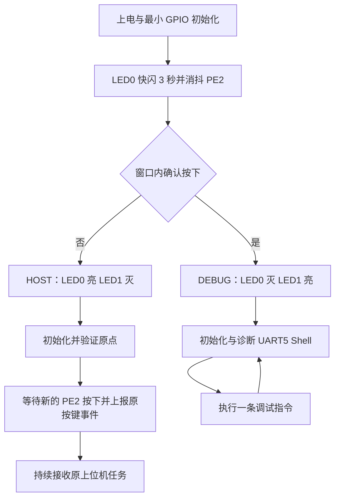

# HUATAI 新机械架构执行方案

> 日期：2026-10-30（Asia/Shanghai）。状态：固件与指定 HMI 已实现，编译和离线模拟验证通过；实机验收未执行。
>
> 原调研阶段仅写方案；2026-10-30 已按下述规格落地 FW 与指定 HMI，视觉上位机程序保持原样。第 1–13 节保留方案/调研基线用于审查，旧“当前/未实现”快照不代表最终代码状态；实际实现、API、构建和偏离见附录 B 及《机械架构变更验证记录.md》。本次未烧录、未部署、未做实机验证。

## 1. 基线、范围与不可改变的约束

### 1.1 唯一基线

| 代号 | 绝对路径 | 用途 |
|---|---|---|
| FW | `C:\Users\ZLK\Downloads\HUATAI (1)\HUATAI-NEW` | 本次修改的 STM32F407ZGT6 固件；调研时 Git HEAD 为 `95c1662` |
| REF | `C:\Users\ZLK\Downloads\HUATAI (1)\HUATAI (2)` | CoreXY 算法参考；调研时 Git HEAD 为 `e6c6937`，以实际工作区文件为准 |
| HMI | `D:\BaiduNetdiskDownload\ApusIDE2_v20250930\ApusIDE2_v20250930\workspace\TEST` | 本次修改的 ApusIDE HMI 工程 |
| HOST | `FW\classic-new` | 视觉上位机及串口协议行为基线，只读验证 |
| SHELL | `FW\letter-shell-3.1.2` | 已存在的 Letter Shell 3.1.2 源码，优先使用本地版本 |

FW 内也有一个未跟踪的 `TEST/` 副本。**不能把它当成指定 HMI 工程，不能只改副本后宣称 HMI 已完成。** 执行前读取 FW、HMI 的 `AGENTS.md` 和实际待改目录下的更具体约束。REF 只读，不回写。

调研时 FW 已有未跟踪的图片、IDE 配置、构建日志、HMI 副本、Shell 目录等。不要清理、覆盖或顺手提交这些用户文件。先记录 `git status`，将自身改动与已有文件区分。

### 1.2 范围边界

1. 只从 REF 迁移 CoreXY 运动学、运动规划计算及耦合到位判断；适配本工程已有电机通讯接口。不要复制 REF 的 `main.c`、`usart.c`、`dma.c`、`tim.c`、`gpio.c`、中断文件、`.ioc`、启动文件或整个 Keil 工程。
2. USART1 的 Emm_V5 协议、UART/DMA 配置和接线继续使用 FW。新增 UART5 Shell 接收、LED 和按键应用逻辑属于本次目标所需的本工程适配，不属于迁移参考工程底层。
3. HOST 的 Python、识别算法、标定文件、服务脚本、串口帧格式、状态码、识别触发方式、重试及超时行为均不改变。可以更新描述新接线的说明文档。
4. HMI 原 `1..72` 形状×颜色映射及对应图片不变；用户已允许新增 MCU→HMI 分类记录帧，由固件传送分类 ID。
5. `.ioc` 不手工修改，不运行 CubeMX 重生成。生成文件只改 `USER CODE` 区；新应用文件不受这些生成标记限制。可以在 Keil 工程加入必要应用/Shell 文件和 include 路径。
6. 保持裸机实现、现有阻塞式电机通信和 SPI 刷屏，不为本次工作引入 RTOS 或改成脉冲驱动。

## 2. 用户已确认的最终行为

| 项目 | 决定 |
|---|---|
| LED 接线 | PF9=LED0、PF10=LED1，均低电平亮 |
| Shell | UART5：PC12=TX、PD2=RX，115200、8N1、无流控 |
| 实体按键 | PE2，低电平按下，上拉输入；替代 PE4 高有效逻辑 |
| 开机选择 | LED0 快闪 3 秒；窗口内消抖确认 PE2 按下则选择 DEBUG，否则 HOST；模式锁定至复位 |
| HOST 指示 | LED0 长亮，LED1 灭 |
| DEBUG 指示 | LED0 灭，LED1 长亮 |
| HOST 启动识别 | 3 秒窗口结束、初始化完成后，再次按 PE2，沿用原按键事件触发上位机；不自动伪造启动按键 |
| 零点 | XY 与托盘都以本次上电时的机械位置作为原点，不找限位、不主动回机械原点 |
| 固定释放点 | 暂定 `(0,0) mm`，通过 `APP_RELEASE_X_MM` / `APP_RELEASE_Y_MM` 宏控制 |
| CoreXY 范围 | `0≤X≤215 mm`、`0≤Y≤205 mm`（2026-11-09 按新边界更新） |
| 旧坐标补偿 | 删除“X、Y 都大于 80 时各减 10 mm”的分支，直接使用合法的上位机坐标 |
| 分类分配 | 新形状×颜色按首次出现顺序分配 ID1..ID6，下一新类回到 ID1；同类记住已分配 ID |
| 托盘位置 | ID1..ID6 分别为 0°、60°、120°、180°、240°、300° |
| 托盘方向 | 固定单方向；禁止最短路径策略。300°→0° 为继续同方向转 60° |
| HMI 记录 | 释放动作完成后追加分类记录，包含固件给出的 ID；失败且未释放时不追加成功记录 |
| HMI 调试 | Shell 单次发送原 HMI 指令码仅用于预览，不占用、修改生产分类 ID，也不追加生产记录 |

“同类同 ID”并不意味着“每个 ID 只对应一种材料”：第七种新类也使用 ID1，第一种材料仍保持 ID1。这是明确允许的六槽循环复用，不能擅自拒绝第七类或清除旧类映射。

## 3. 规划前的实际初始化核对

以下结论来自磁盘源码、工程配置和调用链审查；未通过探针读取运行寄存器，未核实实际接线电平和电机参数。执行后仍需按验收表实测。

### 3.1 外设及资源审计

| 资源 | 当前源码实际状态 | 执行要求 / 证据入口 |
|---|---|---|
| 系统时钟 | `SystemClock_Config()` 使用 HSI→PLL，M=8、N=168、P=2；SYSCLK/HCLK=168 MHz，APB1=42 MHz、APB2=84 MHz | APB1 定时器=84 MHz，APB2 定时器=168 MHz；勿根据 Keil `CLOCK(12000000)` 字符串推导运行时钟 |
| SysTick | HAL 默认 1 ms；`SysTick_Handler()` 调用 `HAL_IncTick()`；优先级 15 | 保留 HAL 时基，用于运行时调度，见第 4 节 |
| TIM13 | `MX_TIM13_Init()` 已调用；PSC=0、ARR=65535；已使能共享 IRQ，但未见 `HAL_TIM_Base_Start[_IT]` | 当前不是应用毫秒计时器；不可因“有初始化”就认为已经运行 |
| TIM8/TIM13 IRQ | `TIM8_UP_TIM13_IRQHandler()` 同时调用两者 HAL handler，NVIC 优先级 0 | 不更改或重复占用该共享中断 |
| LED0/LED1 | GPIOF 时钟已开；现有 GPIO 初始化没有配置 PF9/PF10 | 在应用层配置推挽输出，配置前将两位 ODR 置高，避免上电同时亮 |
| PE2 | `gpio.c` 已配置输入、`GPIO_PULLUP`，`.ioc` 也一致 | 直接使用该硬件布局；按下判断必须改成 `GPIO_PIN_RESET` |
| 旧按键 | `main.h` USER CODE 中 `BTN_Pin=GPIO_PIN_4`；`Button_Init()` 又把 PE4 配成下拉；`Button_Poll()` 检测高电平 | 修改宏、初始化、采样及注释；消抖保持 5 ms 采样、20 ms 稳定判定 |
| UART5 | `MX_UART5_Init()` 已调用；PC12/PD2 AF8、115200 8N1，TX_RX；未使能 NVIC、未启动接收、无应用 IRQ handler | 新增应用层 NVIC、UART5 IRQ、独立接收环及 Shell 端口 |
| USART1 电机 | PA9/PA10 AF7、115200 8N1；DMA2 Stream2 RX / Stream7 TX；USART1/DMA IRQ 优先级 0 | 保留 DMA+IDLE 接收、`UART_RxQueue*` 和 Emm_V5 底层，三台电机串行占用总线 |
| USART2 上位机 | PA2/PA3 AF7、115200 8N1；`HostLink_Init()` 在应用层开优先级 5 的 IRQ、单字节 IT 接收 | 保持现有协议；不要改成 Shell 或混入调试文本 |
| USART3 HMI | PB10/PB11 AF7、115200 8N1；外设已初始化 | 当前发送被 `SCREEN_LEGACY_HMI_ENABLE=0` 关闭；恢复 TX 即可，本方案不要求 HMI 回传 ACK |
| 真空泵/阀 | **TIM1_CH1/CH2，PE9/PE11**；`Vacuum_Init()` 重配 PSC=167、ARR=19999，启动 PWM | 真实实现不是旧文档写的 TIM2；保留两路 PWM 与现有动作时序 |
| 升降吸盘 | **TIM3_CH1，PA6**；`AuxServo_Init()` 重配 PSC=83、ARR=19999，更新事件、启动 PWM | 现有角度 UP=240、DOWN=80、FULL=10、RELEASE=200；保留当前已用动作，见第 9 节 |
| 其他定时器 | TIM2_CH2/PA1、TIM4_CH2/PD13、TIM8_CH2/PC7、TIM9_CH1/PE5 已生成初始化；未发现应用启动这些 PWM | 不据此新增控制负载；不要把它们误写成正在驱动真空或送料 |
| ST7789 | SPI1 PA5=SCK、PA7=MOSI；PF12=DC，PB12=BLK，PB13=CS，PB15=RST；SPI 分频 2，阻塞 TX | 保持屏幕驱动和接线；PA6 已用于升降，不是屏幕 MISO |
| 帧缓冲 | `ext_sram.c` 实际静态分配内部 `320×120×2=76800` 字节缓冲，两块视口刷满 320×240；`ExtSram_Init()` 空实现 | `SCREEN_FSMC_ENABLE=0`，不存在本次运行中的 FSMC_A2/PE2 冲突；不要恢复外部 SRAM |
| 显示选择 | `SCREEN_PAGE_SELECT=1` 显示几何页；`HMI_SendCode()` 还调用本地 `AppDisplay_SetGeometryCommand()` | 改成调试页，解除分类记录与本地几何页耦合 |
| 送料电机 | 地址 3，`tray_motor.c` 已加入 Keil；`main.c` 跳过 `Tray_Init()`，HOST 流程不转托盘 | 恢复初始化，并将应用接口从直线毫米送料改成绝对槽角定位 |
| Letter Shell | `letter-shell-3.1.2/src` 已存在，未加入 Keil；默认 `SHELL_TASK_WHILE=1`、`SHELL_GET_TICK()=0` | 必须做裸机配置，不能直接照搬 FreeRTOS demo |
| 编译器 | Keil target=`HUATAI`，`uAC6=0`，ARMCC 5.06 update 7 build 960，C99 | 保持 AC5，验证 Shell 命令注册和 RAM 余量，不擅自升级 AC6 |

证据文件：`Core/Src/main.c`、`gpio.c`、`usart.c`、`tim.c`、`dma.c`、`stm32f4xx_it.c`、`button.c`、`vacuum.c`、`aux_servo.c`、`ext_sram.c`、`screen.c`，以及对应头文件、`HUATAI.ioc`、`MDK-ARM/HUATAI.uvprojx`。

### 3.2 必须处理的现有调用链细节

- `main.c` 当前先初始化屏幕、等待，再初始化真空/升降/XY；屏幕初始化额外等 1 秒，main 再等 1 秒，升降初始化又有 2 秒稳定和 1 秒抬升等待。**不能在这些操作结束后才开始所谓“上电 3 秒”选择窗口。**
- `app_display.c` 提供了强定义 `HAL_Delay()`，其等待循环调用 `AppDisplay_Service()`。新增服务时只能有一个 `HAL_Delay()` 定义，并保持显示未初始化时可安全返回。
- 所有 HAL UART 完成/错误回调目前集中在 `host_link.c`，只处理 USART2。UART5 必须合并分发或统一迁移为一个分发器，不能新增第二个同名全局回调。
- `UART_RxQueueReset()` 是 USART1 全局接收队列操作；XY 和 Tray 不能并行执行，不允许 Shell 在自动流程中插入电机指令。
- 当前 HOST `cmd_box[73]` 在初始化时全部设为未分配，按新类别顺序轮转六盒。这就是要保留的分类分配语义；它位于固件 `App_RunHostCommandLoop()`，不是需要改动 Python 的逻辑。
- 当前 `HMI_SendCode()` 在 ACK 后、拾放前调用。新生产记录必须移到释放成功后，不能只打开宏而保留旧调用时机。
- 当前最后停靠 `PickPlace_MoveTo(HOME)` 的返回值被忽略。新流程必须将停靠失败反馈为 FAILED，不能报 DONE。
- 当前 `PickPlace_XYResultText()` 的默认分支返回 `OK`。增加原点错误枚举时必须同步处理，未知错误也不能显示 OK。
- 当前 `Tray_PositionNearTarget()` 用 `abs(abs(actual)-abs(target))` 容差判断，会混淆正负位置；角度改造后必须改为正确的带符号累计位置判断。

## 4. 计时器结论：使用 SysTick，不启用 TIM13

依据现状选择 `HAL_GetTick()` 的 1 ms 时基。启动 3000 ms、LED 半周期 100 ms、按键采样 5 ms/消抖 20 ms、串口超时、Shell 双击/历史操作都不需要额外硬件计时器。电机自身执行脉冲，MCU 不用 TIM13 产生步进脉冲。

TIM13 当前 84 MHz/(0+1)/(65535+1) 约 1281.74 Hz，周期约 0.780 ms，既未启动，也不是 1 ms 配置；启用它还涉及 TIM8 共享中断。此次保留现有生成初始化但不启动，避免引入第二套时间基准。

实施规则：

- 时间比较统一用无符号差值：`(uint32_t)(now - start) >= interval`，验证 32 位 tick 回绕。
- 不重写 `HAL_InitTick()`，不改变 SysTick 优先级，不在 SysTick/UART ISR 内调用屏幕、Shell 解析、HAL_Delay 或电机动作。
- 启动选择使用主线程轮询和 tick；快闪采用 100 ms 翻转一次（完整周期 200 ms，即 5 Hz），做成配置宏。
- 普通运行保留同步动作，但在应用等待点服务显示/上位机接收。`HAL_Delay()` 的服务钩子绝不能调用可执行新运动的 Shell 命令解析器。
- UART IRQ 只收字节、维护缓冲和状态；不得为保护缓冲长时间关中断，否则 SysTick 和 HAL 超时都会失效。

## 5. 启动和模式选择

### 5.1 建议落点与顺序

在 `main.c` 的 `USER CODE SysInit` 中（`SystemClock_Config()` 之后、生成的 `MX_*` 调用之前）调用应用层 `BoardIO_Init()`、按键初始化和 `AppMode_SelectAtBoot()`。BoardIO 自行使能 GPIOE/GPIOF 时钟、配置 PE2/PF9/PF10；不改 CubeMX 生成调用顺序。之后 `MX_GPIO_Init()` 仍把 PE2 配置为相同上拉输入，不触碰 PF9/PF10。

启动顺序：

1. HAL + 系统时钟就绪；两 LED 先灭，开始记录 `boot_start_ms`。
2. 在完整 3000 ms 窗口中持续采样按键、翻转 LED0，LED1 始终灭。窗口内一旦确认按下，锁存 DEBUG，但仍完成 3 秒闪烁。
3. 到期设置最终 LED 状态并锁定模式。推荐宏：`APP_BOOT_SELECT_MS=3000U`、`APP_LED_BLINK_HALF_MS=100U`。
4. 保留生成的 `MX_*` 初始化；启动本工程 USART1 DMA+IDLE；初始化调试屏、USART3 HMI、真空/升降和电机。屏幕启动等待不能侵占前述窗口。
5. 在设备静止、尚未发出 XY/托盘位移指令时，使能并将两台 CoreXY 电机、地址 3 托盘电机的当前位置清零，检查应答和位置反馈。使用用户确认的“上电位置就是原点”，不能写成自动机械回零。
6. 初始化失败记录明确设备/阶段。DEBUG 模式仍能进入 Shell 诊断；HOST 模式不允许执行运动任务，收到任务按原协议报 FAILED。
7. HOST 初始化 USART2 并等待新的 PE2 触发；DEBUG 初始化 UART5 Shell 并显示提示符。上位机反复发送启动通知，较晚初始化 USART2 不需要修改 HOST。

上电时按键已按住也必须在稳定 20 ms 后被识别为 DEBUG。不要只依赖 `Button_Poll()` 的一次边沿，因为旧初始化把当前电平直接作为已消抖状态，会漏掉上电长按。

窗口边界定义：只有在窗口结束前完成稳定判定的低电平才选择 DEBUG；最后不足 20 ms 的抖动/按下不算有效模式选择。进入 HOST 后，若 PE2 仍低，先等其稳定释放，再接受新的按下，防止窗口尾部按键被当成生产启动键。

### 5.2 运行模式隔离



- 模式只由启动窗口决定，运行中按 PE2 不切换模式。HOST 保留第一次按键启动、之后持续识别的行为。
- DEBUG 不能进入 HOST 机械循环、不能向上位机发送触发识别的按键事件。串口来的抓取帧不能放行调试模式的动作。
- HOST 不执行 UART5 运动命令。两种模式通过同一组运动/真空/托盘服务控制硬件，不能各复制一套底层。
- 模式 LED 始终表示所选模式；运行故障通过屏幕/Shell 表示，不擅自改变 LED 含义。

## 6. CoreXY 迁移规格

### 6.1 迁移内容

精读 REF 的 `Core/Src/xy_stage.c`、`Core/Inc/xy_stage.h`、`docs/COREXY.md` 和 `tests/corexy/`，逐函数适配到 FW 的 `xy_stage.c/h`。不是简单替换两条公式，也不是复制参考工程硬件初始化。

保留参考算法这些相互关联的行为：

1. 地址 1 为 M1、地址 2 为 M2；不再将它们直接解释为独立 X/Y 轴。
2. 2GT、20 齿、200 整步、16 细分的参考传动参数给出 `3200 pulse/rev`、`40 mm/rev`、`80 pulse/mm`。删除旧 225→45/220→44 缩放；行程限幅与传动比例解耦。
3. 正解使用带符号脉冲，正负数对称取整；M2 在合法 X/Y 范围内也可能为负。
4. 按双电机实际剩余脉冲比例分配 RPM，长行程为最大配置 RPM，短行程取整后至少 1 RPM；分别计算时间上界后取较大值。
5. 两个绝对目标都下发并置同步标志，包括某电机保持不动的对角线情况；两次命令接受应答都成功后，沿用现有广播同步启动。
6. 绝对命令方向取目标符号，不取本次位移增量符号。返回零点发送绝对零目标，不能发相对零步。
7. 反馈先换成带符号逻辑皮带脉冲；两台位置都读取成功后才一起更新 X/Y、触发显示回调，不能混用新旧轴值。
8. 到位必须同时检查移动电机的新到位状态、两台电机的位置容差、两台电机的堵转状态；旧 `0x9F` 通知不能代替本条命令的接受应答或最终到位证明。
9. 清零应答和双方零位反馈校验成功才建立 `origin_valid`。运动准备/启动/运行失败尝试停止双方并使原点失效；后续不能凭缓存坐标继续跑。
10. 保留原点/反馈诊断字符串，补齐 `XY_RESULT_ORIGIN_ERROR` 的调用方处理；对外提供可检查的原点状态或结果接口，不能只靠 `void XY_SetZero()` 和一行“OK”放行生产。

### 6.2 数学约定与核对值

```text
P1 = round_signed((X + Y) × 80)
P2 = round_signed((X - Y) × 80)
P_feedback = signed_position_units × 3200 / 65536
P_feedback 再按各电机逻辑正方向宏修正符号
X = (P1_feedback + P2_feedback) / 160
Y = (P1_feedback - P2_feedback) / 160
```

| 目标 (mm) | M1 逻辑目标脉冲 | M2 逻辑目标脉冲 |
|---|---:|---:|
| (10,0) | 800 | 800 |
| (0,10) | 800 | -800 |
| (10,10) | 1600 | 0 |
| (45,35) | 6400 | 800 |
| (215,205) | 33600 | 800 |
| 返回 (0,0) | 0 | 0 |

参考方向宏 M1/M2 正方向均为协议 1（CCW）；必须同时作用于命令和反馈。它们是基线配置，不是本机实测结论。方向/比例先用小位移验证，不能因“电机相同”就宣称安装方向已验证。

坐标检查在浮点转整数前完成，拒绝 NaN、Inf、负值及越界；传入上位机原始 mm 坐标，删除旧减 10 mm 分支。该算法是串口点到点联动，独立加减速与整数 RPM 不保证任意斜线严格直线插补，不得在交付说明中夸大。

## 7. 托盘送料电机改造

### 7.1 初始化和接口

- 继续使用地址 3、USART1、Emm_V5。恢复 `Tray_Init()` 的使能、清零应答校验，并新增清零后位置反馈验证和 `origin_valid`。
- 用户确认托盘与 CoreXY 电机相同；软件起始配置采用 3200 指令脉冲/电机圈、65536 位置单位/圈。机构是否有额外传动比仍需装机核实；设显式 `TRAY_MOTOR_REVS_PER_TRAY_REV` 宏，初值 1.0，不能沿用旧 `145 mm/rev` 充当角度参数。
- 应用接口建议：`Tray_MoveToAngle(float angle_deg)`、`Tray_GetAngleDeg()`、`Tray_GetAccumulatedAngleDeg()`、`Tray_IsOriginValid()`、带结果的 `Tray_SetZero()`。初次清零在模式选择后的统一初始化中执行。
- `Tray_MoveForward/Reverse(mm)` 旧接口如保留，不能再由新生产流程调用；清除旧 65/55 mm 往返送料逻辑的活动入口。
- 角度输入规定为 `[0,360]`，360 等价 0；拒绝负角、超过 360、NaN、Inf。`tray 0` 表示转到零角相位，不表示将当前位置重新清零。

### 7.2 固定单方向算法

所有角度相对于本次上电原点，逻辑正向由一个 `TRAY_DIR_POSITIVE` 宏映射到驱动方向；“正向”不代表已经确认从哪个观察面看是顺时针。

```text
target_phase = normalize_0_360(requested_angle)
delta = normalize_0_360(target_phase - previous_target_phase)
next_accumulated_target = previous_accumulated_target + delta
absolute_target_pulse = round(next_accumulated_target × pulses_per_tray_rev / 360)
```

- 若请求相位等于已到位相位，且实测仍在容差内，直接成功；不额外旋转一圈。
- 0→300° 必须沿固定方向转 300°，不能反向转 60°；300→0° 正向转 60°；120→60° 正向转 300°。
- 使用累计目标的绝对脉冲取整，不能每次固定加 `round(3200/6)=533`；六次 60° 的一圈目标必须准确回到累计 3200 脉冲，避免每圈丢 2 脉冲的系统误差。
- 采用累计绝对位置命令，保持同一逻辑方向和单调目标。目标用足够宽的数值类型计算，并在进入 Emm_V5 的 32 位字段前检查溢出；达到可表示范围时返回明确错误，不静默回绕/重新清零。
- 已到位相位是完成校验后提交的逻辑目标；反馈用于验证和报告。微小反馈噪声不能导致“同角度再转一整圈”。
- 发送绝对目标前核对实测累计位置：方向位表达的是绝对坐标符号，并不能自动保证驱动器不会反向寻找目标。若同相位请求已偏离容差，或实测位置超过计划目标且需要反向纠偏，返回位置失配并使原点失效，不发送反向修正，也不擅自多转一圈。对尚未到位的前一条命令不得提交新的逻辑相位。
- 到位使用带符号累计位置和反馈方向宏，不能只比较模 360 相位，更不能使用双重绝对值。容差按现有 20 指令脉冲起步（直连时约 2.25°），此值需按托盘槽口余量调试，不能当成精度承诺。
- 托盘 ACK、状态、位置、超时和堵转处理沿用本工程协议能力；任一失败立即停止本次循环，不能继续 PickUp 或释放。
- 托盘与 XY 顺序执行，托盘命令不设置待广播同步标志，避免随后 XY 广播意外再次触发地址 3。

## 8. 分类和上位机生产循环

### 8.1 分类 ID 的唯一来源

建议提取 `classification.c/h`，维护 `code_to_id[73]` 和 `next_id`。`code=1..72` 的索引仍完全按原形状颜色映射。

```text
初始化：code_to_id 全 0（未分配），next_id=1
新有效任务通过参数验证和去重后：
  若 code_to_id[code]==0：
    code_to_id[code]=next_id
    next_id=(next_id % 6)+1
  id=code_to_id[code]
  angle=(id-1)*60°
```

映射在本次上电会话内保留、复位后清空，延续原固件行为，不新增 Flash 持久化。一个合法任务一旦获分配即保留该映射，即使随后机械失败也不回退 cursor，以防同类因重试改投另一槽。非法帧、越界任务、未启动时丢弃的任务及 Shell 预览不分配 ID。

例：依次出现新 code A/B/C/D/E/F/G，ID=1/2/3/4/5/6/1；再次出现 A 仍为 1，再次出现 F 仍为 6。ID、原 HMI code、上位机 SEQ 是三个不同字段，不能互相替代。

### 8.2 保持不变的 USART2 契约

| 消息 | 固定格式 |
|---|---|
| 上位机抓取 | `AA 55 01 SEQ CMD X_L X_H Y_L Y_H SUM8`，10 字节，X/Y 为无符号小端毫米 |
| 上位机启动通知 | `AA 55 02 00 01 SUM8` |
| 下位机在线 | `55 AA 02 00 01 SUM8` |
| 下位机按键 | `55 AA 82 SEQ STATE SUM8`，按下=1、释放=0 |
| 下位机状态 | `55 AA 81 SEQ STATUS SUM8` |

`SUM8` 是前面所有字节求和的低 8 位；状态值保持 ACK=1、BUSY=2、DONE=3、FAILED=4、OUT_OF_RANGE=5。PE2 极性变化不能改变协议的 PRESS=1/RELEASE=0 语义。

当前 HOST 默认 ACK 超时 1 秒、仅重发一次，动作完成超时 24 秒。必须先 ACK 再执行托盘和拾放，正常 ACK 目标小于 100 ms。总动作时间需要覆盖托盘最坏 300°、XY 来回、吸取/释放、升降和停靠，并在 24 秒内留有余量。不得用反复 BUSY 假定会重置 HOST 的 PICKING 超时；当前 Python 没有这种保证。

不能仅依赖各步骤自己的超时相加：REF 的单次 XY 超时模型包含双加减速保守余量，两次 XY 的上限再加托盘及吸放等待，可能超过 HOST 的 24 秒。设置整个生产任务的统一截止时间，采用 `APP_HOST_TASK_BUDGET_MS=24000U`（从发送 ACK 起算，包含回 HOME），HOST 的完成等待同步为 24 秒。各应用等待/运动轮询都检查剩余预算，并在拥有电机事务的调用层退出和停止；后台服务只能设置超时标志，不能重入 USART1 发停止包。必要时给 PickPlace/Vacuum 的等待增加可返回失败的应用接口，不能中断一个 void 延时后仍假称吸取或释放成功。

任务超时后发送原 FAILED、锁住无效原点，禁止旧动作继续进行时接纳新的 HOST 任务。正常流程若实测无法在预算内完成，记录实际阶段耗时并调试固件/机械参数；不得暗改上位机超时，或单纯扩大任务预算掩盖不兼容。

### 8.3 严格执行顺序

```text
HOST 已由 PE2 启动
  → 收帧、校验、范围检查、去重、原点/配置有效性检查
  → ACK
  → 为 code 查询/分配 ID（只做一次）
  → 抬杯并确认等待结束
  → 托盘单方向转至 (ID-1)×60°，确认到位
  → CoreXY 移至原始抓取坐标
  → 按形状降低吸盘 → 开真空吸取 → 抬杯
  → CoreXY 移至固定 Release 宏坐标
  → 释放（泵关、阀按原时序动作、保持杯抬起）
  → 发送一次 HMI 分类记录(code, ID)
  → 按原 APP_PARK_AFTER_TASK 策略停靠 HOME（当前也是 0,0）
  → DONE；继续等待下一个上位机任务
```

固定 Release 与 HOME 是独立宏：现在数值同为 0,0，未来改 Release 不应隐式改变停靠点。不要再查询 `host_boxes[]` 或遍历 POSITION_1..6，移除生产路径上的旧编译模式分支/入口歧义；新的 HOST/DEBUG 为运行时模式。

去重规则保留当前完整任务键 `(SEQ,CMD,X_raw,Y_raw)`：活动任务重发只返回 BUSY/当前状态；已完成的相同任务只补发最终结果。不得再次旋转托盘、分配 ID、拾放或追加 HMI 记录。不要仅按 SEQ 永久去重，SEQ 会在 255 后回绕。按上位机一次只下发一个任务的现状保留活动项和最近终态即可。

### 8.4 阻塞、缓冲和故障

- USART2 环形缓冲目前仅 64 字节；上位机每秒发送 6 字节通知，机械过程可达数秒至十余秒。新增只做解析/去重/状态回报的 `HostLink_Service()`，在应用等待片段调用；不允许其递归启动第二个任务。
- ISR 不执行机械动作。前台 BUSY 时收到不同任务，使用现有 FAILED 拒绝，不创建无界任务队列。调试模式不接纳 HOST 任务。
- 缓冲溢出必须计数并恢复帧同步；不能把残缺帧当有效任务。全局服务钩子应有初始化检查和防重入，不能在屏幕或 USART1 回调中启动动作。
- ACK/终态发送失败记录诊断，允许原协议重试；UART 故障不能触发重复机械任务。
- 托盘失败发生在吸取前，不继续取料；取料后 XY 故障不得盲目打开阀把物料掉在途中，应停止运动、保留受控的真空状态并显示故障，等待复位/调试处理。
- Release 成功后即是一条真实已分类记录；若随后停靠失败，则该记录保留，但任务回 FAILED。HMI 发送失败只记通信故障，不重做释放，不把已完成机械操作变成重抓理由。
- 故障原点无效时，HOST 后续任务继续按原协议拒绝；不在自动循环中重新清零。DEBUG 下可以通过明确的零点指令恢复，见第 11 节。

## 9. 真空、升降及 ST7789 调试显示

### 9.1 保留现有机械动作

继续使用 TIM1 真空泵/阀、TIM3 升降。吸取沿用 `PickPlace_PickAt()`：长方体用 `AuxServo_LiftDownFull()`，其余用 `AuxServo_LiftDown()`；`Vacuum_PickAndHold()` 在移动中保持泵工作，释放调用 `Vacuum_Release()`。

当前 `PickPlace_ReleaseAt()` 实际不降杯，在抬杯状态释放；`AUX_SERVO_RELEASE_ANGLE=200` 及 `AuxServo_LiftRelease()` 虽存在，但当前流程未调用。本次保持当前释放行为，不根据旧注释擅自增加降杯；若落料高度需要改变，作为明确标定项记录，不混入算法迁移。

初始化应先写安全 CCR，再启动 PWM，并校核预分频装载/更新事件，避免在旧频率或未定 CCR 下产生首帧脉冲；这些修正放在应用层，不改 `MX_TIM*_Init()`。真空/升降的现有等待时间不可为了掩盖上位机 24 秒超时而未经实测直接缩短。

### 9.2 ST7789 只显示调试信息

- 固定使用任务/调试页；移除活动几何分类页面入口，`SCREEN_PAGE_SELECT=0` 可作最小切换，但不能继续从 `HMI_SendCode()` 驱动本地分类绘制。
- 建议内容：HOST/DEBUG 模式、当前动作/故障、XY 实测位置和目标、托盘角度/ID、原点有效状态、真空/升降状态、最近 HOST SEQ/CMD、HOST 在线状态、HMI 发送错误。数字 ID 可作为调试状态显示，但不显示几何分类列表/缩略图。
- 状态 setters 只更新缓存并标记 dirty，`AppDisplay_Service()` 按需限频刷新，例如最多 10 Hz；不得在高频接收回调里整屏刷 SPI。
- 现有 `AppDisplay_SetCommand()` 保存字符串指针；调用者必须传静态存储字符串，或修改接口内部复制到有界缓冲。禁止保存 Shell 栈上临时字符串指针。
- 保留内部半屏缓冲和阻塞 SPI。屏幕初始化失败/未初始化状态下，早期 LED/按键选择仍必须独立工作。

## 10. USART3 HMI 扩展协议与工程改造

### 10.1 不变的形状颜色表

`code = shape_index × 9 + color_index + 1`。颜色偏移 0..8：红、橙、黄、绿、青、蓝、紫、灰、黑。

| 指令码 | 形状 | 图片前缀 |
|---|---|---|
| 1..9 | 正四面体 | RT |
| 10..18 | 三棱柱 | TP |
| 19..27 | 五棱柱 | PP |
| 28..36 | 六棱柱 | HP |
| 37..45 | 圆柱形 | CY |
| 46..54 | 长方体 | CB |
| 55..63 | 正方体 | CU |
| 64..72 | 球体 | SP |

本工程 USART3 对应 HMI 软件 `Wcmn.cpp` 中配置的 `COM2`，两端端口名字不必相同。继续使用 115200 8N1，不改图片路径 `./images/<shape>-<color>.png` 的命名体系。

### 10.2 新帧定义（执行时按此实现）

保留单字节 `0x01..0x48` 作为**调试预览**，只更新当前图片/文字，不追加生产记录。新增有边界和 CRC 的分类帧。为避免元数据中的小整数被旧单字节解析器误当分类码，扩展帧每个数据字节用高位编码的两个半字节发送。

线格式固定 **22 字节**：

```text
F0 [D0 的高/低半字节] ... [D9 的高/低半字节] F1
每个半字节 n(0..15) 在线上编码为 0x80 | n，因此中间 20 字节均为 0x80..0x8F。
```

解码后数据：

| 字节 | 含义 |
|---:|---|
| D0 | 协议版本，固定 1 |
| D1 | TYPE：1=分类完成记录；2=新生产会话清空记录 |
| D2..D5 | `record_sequence`，无符号 32 位小端；TYPE1 从 1 递增，TYPE2 为 0 |
| D6 | 原始形状颜色 code，TYPE1 为 1..72；TYPE2 为 0 |
| D7 | 固件分配 ID，TYPE1 为 1..6；TYPE2 为 0 |
| D8..D9 | 对 D0..D7 计算 CRC16/CCITT-FALSE，低字节先发 |

CRC 参数：poly=0x1021、init=0xFFFF、refin=false、refout=false、xorout=0。CRC 的输入是解码后的 8 字节，不包括 F0/F1 或半字节编码。标准校核串 ASCII `123456789` 的 CRC 应为 0x29B1。

联调固定样例（已用独立 Python CRC 实现核对长度和数值）：

```text
分类记录：record_sequence=1，code=19（五棱柱-红），ID=3
D0..D7: 01 01 01 00 00 00 13 03
CRC16: ED6F；在线 CRC 数据低字节 6F、高字节 ED
完整 22 字节：
F0 80 81 80 81 80 81 80 80 80 80 80 80 81 83 80 83 86 8F 8E 8D F1

新会话清空：
D0..D7: 01 02 00 00 00 00 00 00
CRC16: 160E
完整 22 字节：
F0 80 81 80 82 80 80 80 80 80 80 80 80 80 80 80 80 80 8E 81 86 F1

调试预览 code=19：只发送一个字节 13，不发送 ASCII 字符串 "19"。
```

TYPE2 在 HOST 会话初始化时发送一次，清空 HMI 生产历史；DEBUG 不主动清空生产历史。TYPE1 仅在每次实际释放完成时构造一次，不在上位机重发路径重发。分类表归固件所有；HMI 不根据历史顺序自行分配 ID。

此方案保持原 `1..72` 映射，扩展元数据不会被旧 HMI 误显示成额外材料；但旧 HMI 不理解扩展帧，**生产分类显示要求固件与指定 HMI 同步升级**。

### 10.3 接收、显示和失败语义

- `Wcmn::wMCom3_vch_cb()` 必须改成可跨 `readData()` 调用保留状态的流式解析器；处理拆包、多个包粘连及混入原单字节预览。
- 看到 F0 开始收集；20 个编码字节必须均在 0x80..0x8F，末尾必须 F1；新 F0 可重启组帧。非法编码/长度/CRC/版本/type/字段范围一律丢弃，不回灌为原指令字节。
- 接收超时建议 200 ms，用 HMI 自身单调时钟；半帧超时后丢弃。空闲收到 1..72 才执行预览，其他无关字节忽略。
- `HmiApp::commandHistory` 从 `vector<int>` 改为包含 code、ID、record_sequence 的记录类型。Frm02 新增或替换 `appendRecord()`；行文示例：`ID:3  指令:19  五棱柱-红`。
- `Frm02::onLoad()` 从统一记录表恢复，不在页面重开时重新分配 ID。多条相同 code 可以是多件物料，不能因为同类相同就全局去重隐藏。
- 串口解析和 UI 更新必须保证接收顺序。现有代码每个字节启动一个 `AsynWorker`，不要依赖多个 worker 的完成先后顺序；采用单个有序队列/批处理，将完整记录按顺序投递到 UI 线程。
- 预览不写生产 history，不消耗 record_sequence，不改变固件分类映射；可显示“调试预览 / 无生产 ID”。
- HMI 原有历史是内存数据，本方案不增加断电持久化或补齐丢失历史。可保留最近 256 条记录以限制内存，淘汰时同步列表和渲染索引；当前记录的 ID 始终来自帧，不依赖历史是否完整。
- 不引入 HMI ACK，不宣称 `HAL_UART_Transmit()==HAL_OK` 等于屏幕已接收/渲染。将 `hmi_link.h` 的“panel accepted”注释改为“本地 UART 发送完成”。
- 分类扩展帧使用一次发送，不盲目沿用原 `HMI_LINK_TX_RETRY=2` 自动重试，以免已送达但本地报错时重复追加；记录错误并继续报告真实机械结果。若未来要求可靠历史/掉线补发，需要另行设计会话 ID、ACK 和去重协议，本次不声称具备。
- HMI 单独重启或晚于 MCU 启动时，之前历史可能丢失，但后续每条记录都携带真实 ID，仍能正确显示；MCU 重启发送的 TYPE2 若未被收到，旧历史可能保留，不能把“清屏通知”描述为可靠握手。

### 10.4 HMI 文件范围

修改指定 HMI 的 `src/HmiApp.h/.cpp`、`src/pages/Wcmn.h/.cpp`、`src/pages/Frm02.h/.cpp` 中必要的用户代码；尽可能利用现有列表行文字显示 ID，不为此改造页面布局。遵守 HMI 的 CUSTOM 标记和文件归属，不修改 `lib/` 框架。在该 HMI 工程内新增实现说明，记录新协议、预览与生产记录差别及升级顺序。

## 11. Letter Shell 接入

### 11.1 裸机端口与配置

1. 使用本地 3.1.2，保留许可证。加入 `shell.c`、`shell_ext.c` 和需要的头文件；不加入 FreeRTOS demo、telnet、文件系统、伴生扩展。
2. 建议采用**静态命令表**：`SHELL_USING_CMD_EXPORT=0`，在应用 `shell_commands.c` 中定义唯一的 `shellCommandList`/`shellCommandCount`，参考原 `shell_cmd_list.c` 的默认用户、键处理、help 项；不要同时编译原表造成重定义。这样不要求更改现有自动 scatter/linker section 规则。
3. `SHELL_TASK_WHILE=0`、`SHELL_GET_TICK()=HAL_GetTick()`、`SHELL_MAX_NUMBER=1`、参数最大数保持 8、格式化输出缓冲 128、`SHELL_EXEC_UNDEF_FUNC=0`、伴生/锁/动态分配扩展关闭。以 CMD_MAIN 的 argc/argv 包装函数显式解析参数，避免依赖函数自动参数转换传 float。
4. 注意 `shell.h` 用引号包含同目录 `shell_cfg.h`；不能只在 Core/Inc 放一个同名文件并假设优先级能覆盖。明确调整实际生效配置，或让唯一的 Shell 配置转引应用配置；交付时记录采用方式。
5. 新增 `shell_port.c/h`，静态 Shell 对象、初始建议 512 字节编辑/历史缓冲、独立 256 字节 UART5 RX 环；根据 Shell 的缓冲分配规则核实单行最大长度，并明确报错，不默默截断执行。
6. 应用层使能 `UART5_IRQn`，优先级建议 6（低于 USART1=0 和 USART2=5）；在 `stm32f4xx_it.c` 的 USER CODE 区新增 `UART5_IRQHandler()`，调用 `HAL_UART_IRQHandler(&huart5)`。
7. 单字节 `HAL_UART_Receive_IT()`，完成回调只入队并重新武装；错误回调独立处理 UART5 ORE/FE/NE、接收状态恢复、错误计数，不能中断 USART2 或 USART1。
8. 全工程只有一个 `HAL_UART_RxCpltCallback()` 和一个 `HAL_UART_ErrorCallback()`，按 Instance 分发给 HostLink/ShellPort。保留 USART1 DMA+IDLE 原处理，不把它替换成字节 IT。
9. 前台 DEBUG 循环取字节并调用 `shellHandler()` 或非循环 `shellTask()`；写接口用 UART5 有限超时发送，正确返回实际发送长度/失败。禁止把 printf 重定向到 USART1/2/3。
10. Shell 动作先保留同步执行模式；执行期间不再次进入 Shell 解析，不在 HAL_Delay 服务中解析 Shell。动作返回后丢弃忙碌期间积压的未执行输入并提示重输，防止粘贴命令在几秒后连续意外执行；缓冲满后丢弃受损整行至行结束，不能执行截断命令。

不要宣称同步 Shell 在长动作中支持即时软件急停。本次用户要求的五类调试命令不是异步急停通道；若后续需要可打断动作，应另做非阻塞运动状态机。

### 11.2 明确命令契约

| 命令 | 行为 | 校验/返回要求 |
|---|---|---|
| `move <x_mm> <y_mm>` | 抬杯后调用 CoreXY 绝对移动 | 有效原点、0..215/0..205、有限浮点数；返回实际位置或明确 XY 错误 |
| `lift up` / `lift down` / `lift full` | 对应现有抬起、普通降低、完全降低 | 不自行移动 XY；等待现有舵机稳定时间后返回 |
| `tray <angle_deg>` | 按第 7 节固定单方向定位至目标相位 | 有效托盘原点、0..360；返回当前相位及累计角度 |
| `vacuum on` | 关闭释放阀，再开启并保持真空泵 | 不隐式执行 XY 或升降；返回泵/阀状态 |
| `vacuum off` | 停泵并按 `Vacuum_Release()` 时序泄压，最终关闭释放阀 | 语义是停止吸附并释放，不能仅停泵后仍保持密闭真空 |
| `hmi <code>` | 在 USART3 发送一次原始 1 字节码，用于 HMI 预览 | 十进制整数 1..72；不分配 ID、不追加生产记录、不改托盘 |
| `status` | 输出模式、XY/托盘原点有效性、最近位置/目标、真空、错误计数 | 优先读缓存；额外位置查询必须在没有活动电机事务时执行 |
| `zero xy` / `zero tray` | 将设备当前位置设为软件原点，检查应答和反馈 | 仅 DEBUG 且静止可用；不是限位回零；清楚打印重新建立原点 |
| `help` | 列出命令、单位、范围和示例 | 至少支持上述五类必需调试能力 |

额外 `status`、`zero` 是让本工程诊断和原点失效恢复可用的配套命令，不改变上位机协议。所有命令严格验证 argc、完整数字消费、范围和非有限值；非法参数不产生任何硬件动作。统一结果格式可用 `OK ...` / `ERR <module> <reason>`。

Keil map 需核对 Shell 缓冲和内部 76800 字节帧缓冲共存时的 RAM/stack 余量。不能把 DMA 缓冲放到 DMA 不可访问的 CCM 来腾普通 SRAM，也不要恢复旧外部 SRAM 地址。

## 12. 建议的实施拆分及文件清单

| 阶段 | 文件/模块 | 完成条件 |
|---|---|---|
| A | 新 `app_config.h`、`board_io.c/h`、`app_mode.c/h`；`button.c/h`、`main.h` USER CODE | PE2 极性、LED 及 3 秒选择可独立验证；配置有唯一来源 |
| B | `xy_stage.c/h`、`pick_place.c` | CoreXY 正反解、双电机同步、原点有效性及错误文本适配；未改参考底层 |
| C | `tray_motor.c/h` | 恢复地址 3 初始化，角度接口、固定方向累计位置、到位及超时 |
| D | 新 `classification.c/h`、建议 `app_controller.c/h`；`main.c` USER CODE | 抽离 HOST 业务，固定 Release，ID 循环，去重和故障处理 |
| E | `hmi_link.c/h`、指定 HMI 的应用/页面文件 | 新记录帧、旧预览码、有序解析、明确 ID 显示 |
| F | `app_display.c/h`、`screen_config.h` | 仅调试页、限频刷新、无几何列表入口、服务无重入 |
| G | Shell 源及配置，新 `shell_port.c/h`、`shell_commands.c`；UART 回调/IRQ USER CODE | 五类调试命令及诊断可用；全局回调唯一，模式隔离 |
| H | Keil 工程、测试/说明 | 正确添加编译项和 include；构建、回归、实测记录、更新全部文档 |

阶段顺序可按依赖小幅调整，但必须先完成第 3 节复核，再修改代码；每阶段都有可审查 diff。不要以“文件已复制”作为运动迁移完成，不要只改宏而遗漏 HOST/HMI 调用链。

应用配置至少集中：模式选择/LED 时间、Release/HOME 坐标、CoreXY 行程与传动参数、托盘方向/传动比/脉冲每圈/容差、分类槽数 6、串口缓冲大小、调试刷新周期。运行时不得提供修改生产协议或绕过原点校验的隐藏开关。

## 13. 验证与交付验收

### 13.1 构建和自动化验证

原调研轮仅写文档；实施后的实际构建见附录 B。改 C 源后使用 `mdk-armclang-build-check` 技能；本机已发现 `D:\Keil_v5\UV4\UV4.exe`。保持 target `HUATAI` 和工程选择的 ARMCC5：

```powershell
$migrationProject = 'C:\Users\ZLK\Downloads\HUATAI (1)\HUATAI-NEW\MDK-ARM\HUATAI.uvprojx'
$migrationLog = 'C:\Users\ZLK\Downloads\HUATAI (1)\HUATAI-NEW\MDK-ARM\build_mechanical_migration.log'
& 'D:\Keil_v5\UV4\UV4.exe' -b $migrationProject -t 'HUATAI' -j0 -o $migrationLog
```

分阶段使用 `-b`；最终用 `-r` 完整重建一次。等待进程和日志完成，以日志终结的 Error/Warning 汇总和链接结果判断，不能仅以 PowerShell 的 `$LASTEXITCODE` 或旧日志判成功。记录 `BUILD_RESULT`、错误/警告数、逐条诊断、日志路径；新增警告修复，遗留警告明确说明。

HMI 用指定工程的 ApusIDE/实际可用交叉编译器构建 C++11 目标。HMI 的 AGENTS 中记录了旧 SDK 路径，使用前重新核实，不能用 x86 编译通过代替 ARM HMI 构建。未得到构建结果时明确标记待验证，不伪造通过。

可复用现有测试入口：

- `python tools/selftest_host_link.py`：修改为新控制模块的真实路径，继续覆盖真实固件解析与 HOST 循环；不能只测试旧提取出来的无用 main 分支。
- `python classic-new/scripts/selftest_button_logic.py`：上位机原样回归，不为适配新固件修改上位机逻辑。
- REF 的 `tests/corexy/` 可作为迁移测试参考，测试必须编译/调用 FW 的最终算法。原脚本的工具/Unicorn 依赖需重新探测，不直接照抄过期路径，也不把旧测试结果当本工程结果。

最低自动化用例：

| 分组 | 必须覆盖 |
|---|---|
| 启动/按键 | 不按进入 HOST；有效按下/上电长按进入 DEBUG；抖动不触发；3 秒边界；HOST 必须先释放再新按；tick 回绕 |
| CoreXY | 第 6 节核对值、负 M2、返回绝对零、相对移动、45°保持轴、NaN/Inf/边界、双反馈原子更新、清零拒绝、旧到位包、单轴堵转/读失败、同步启动失败 |
| 托盘 | 0→300 转 300；300→0 转 60；120→60 转 300；同角不动；六步累计 3200；多圈无取整漂移；非法角、反馈符号反向、超时、溢出、清零失败 |
| 分类 | A..G=1..6/1；重复 A/F 仍=1/6；失败保留映射；非法帧/Shell 不分配；复位清空 |
| HOST | 原帧字节/校验/状态码不变；未按键不动作；重复任务只补状态且不重复 HMI；SEQ 回绕；坐标无旧偏移；托盘在 PickUp 前；固定 Release；停靠失败不报 DONE；整体预算超时退出且不并行执行新任务 |
| HMI | CRC 标准校核；首尾 code=1/72、ID=1/6；分字节拆包、连续包、错误 CRC、非法字段、半帧、噪声、预览不记账；页面重开不重复；串口批次保持顺序 |
| Shell | argc、非法数值、NaN/Inf、超长行/溢出、忙时积压输入、UART 错误后恢复、HOST 禁止执行 Shell 动作、DEBUG 禁止 HOST 驱动 |

### 13.2 实机验收顺序

1. 首先验证 GPIO 极性：LED 两路单独亮灭；PE2 松开高、按下低；UART5 PC12 TX/PD2 RX 对接正确。确认原 PE4 接线不再影响模式/启动。
2. 分别上电不按、窗口内短按、上电长按、边界抖动，测 LED0 快闪窗口约 3000 ms。确认机械初始化和屏幕延时未吞掉按键窗口。
3. DEBUG 模式检查 Shell 可用，即使某个电机断开，也能看到具体故障而非永久卡死；无 HOST 指令驱动机械动作。
4. 在确认本次上电位置是预期原点后，低速做 XY 小幅 `(1,0)`、回零、`(0,1)`、回零、`(1,1)`，再逐步扩大。实测每毫米比例和符号；最后验证范围及 Release=HOME=(0,0)。
5. 确认托盘驱动细分/传动比、方向和第一个槽口零角。逐个测试 0/60/120/180/240/300/0，并测试 0→300，验证没有反转及累计漂移。
6. 独立验证 `lift` 和 `vacuum` 命令，检查抬杯动作与真空保持/泄压。确认释放时不降杯的现有策略满足新托盘高度；若不满足，记录参数变更后再运行自动拾放。
7. `hmi 1`、`hmi 72` 各只发一字节、只预览。按新帧注入 code/ID，确认列表 ID 与图形一致；同类多件可有多条记录，同 ID 不等于同图片。
8. HOST 模式再按 PE2，原上位机启动识别。抓串口验证原协议不变、先托盘后 PickUp、固定点释放；第七种材料回用 ID1。
9. 注入重复帧/越界/托盘断线/XY 反馈失败/HMI 断线，验证无重复动作、无假 DONE。HMI 故障不触发重抓；机械故障不继续落料。
10. 测量从接收有效帧到 ACK、到 DONE 的最坏实际耗时，正常 ACK <100 ms，完整循环低于原上位机 20 s 超时并留余量；验证持续心跳时接收环无静默溢出。不能通过修改 HOST 超时使验收通过。

构建通过、模拟测试通过、实机验证通过是三个独立结论。没有连接硬件时，只完成前两类并列出第三类待测项，不宣称已验证精度、方向或机械可靠性。烧录/部署属于另一步交付，不自动等同于编译授权。

## 14. 全部代码落地后的文档更新（交付必需）

执行模型必须在同一任务收尾时回写，不得只交代码并说“以后补文档”：

1. **本文件**：将状态改为“已实现 / 部分验证 / 全部验证”的准确描述；填写实际模块路径、最终 API/宏、采用的 Shell 配置方法、新 HMI 协议最终字节规范、构建日志与测试结果、仍未实测的项目。方案若有偏离，先说明原因并保持用户确认的行为不变。
2. **FW `AGENTS.md`**：修正 PE2 低有效、PF9/PF10、UART5 Shell、TIM1 真空/TIM3 升降、内部半屏缓冲、CoreXY、托盘角度和新启动模式；修正“没有 Git 历史”“没有测试/命令行构建”的过时描述。
3. **`上位机联动说明.md`、`classic-new/SERIAL_PROTOCOL.md`**：保留上位机字节协议，更新 PE2 接线、启动窗口后再次按键、固定 Release、六 ID 循环、无旧坐标补偿、故障和去重语义；避免修改 HOST 程序行为。
4. **`屏幕系统说明.md`、`屏幕联动说明.md`**：ST7789 只作调试，HMI 负责分类，UART3 引脚、原 72 码映射和新帧；删除运行配置中外部 SRAM/FSMC、几何页默认及 TIM2 真空等旧结论。
5. **指定 HMI 工程说明**：新增/更新 `通信与分类显示说明.md`，写入预览与生产记录的不同含义、字段及 CRC、ID 由固件提供、有序 UI 更新、内存历史限制、双端升级及无 ACK 的实际限制。
6. **调试说明**：在 FW 新增 `docs/调试与首次上机.md`，给出 UART5 参数、接线、完整 Shell 示例、原点语义、方向/比例/托盘零槽/释放高度标定步骤，明确 `tray 0` 与 `zero tray` 的区别。
7. **验证记录**：记录编译器、target、构建命令、Error/Warning、自动测试、实机矩阵、最终参数及未验证事项。构建产物、`.axf/.hex/.o`、临时日志不进入提交；说明中可给出本地日志路径。

最终交付应能回答：修改了哪些文件、上位机为什么仍可直接使用、启动如何选择模式、托盘如何分配/旋转、HMI ID 如何确保来源一致、Shell 如何操作、哪些测试实际通过、哪些机械参数仍需实测。

## 附录 A：调研快照指纹

下列 SHA-256 用于执行前识别基线漂移；不是要求把工作区复位到这些版本。若不同，重新核对相关模块，保留用户新改动。

| 文件 | SHA-256 |
|---|---|
| FW `Core/Src/main.c` | `56C4C061F2DB740B33B25689849D669C4DE8A12A4B2824881F7951937847DB63` |
| FW `Core/Src/xy_stage.c` | `F37F11258666F4808B232B67B426D7960B561B638BCA4198E1FF9230DCB8748F` |
| FW `Core/Src/host_link.c` | `2D68213C3899F47AF070A19F8494FD3C55CEAD0B8F5CA503B0E31FAFFB20E0FF` |
| FW `Core/Src/hmi_link.c` | `B2FAEBC9AC10AC747E71E711E2C176765B8C04FA17E0318ECF8E8D4DFB45095C` |
| FW `HUATAI.ioc` | `60C4245FF2F4BE2BD91A0713DE88555E34032CD27EC8F4C6DC6D66875502DA59` |
| REF `Core/Src/xy_stage.c` | `AE8821FFA5B07157250F467B95B3CB3C2D0A7029852A7F3FC2F4F9D9510511CE` |
| HMI `src/pages/Wcmn.cpp` | `00FF5F3F6E56864A7A1BDE727EFD7A1658D89E2E8EB8A57ADF00FD77A5C1F273` |
| HMI `src/pages/Frm02.cpp` | `A9FC0A88F924C5E81A623D965AFC4B175B719EEE066B5BFB399444EFFAA0D449` |

## 附录 B：执行完成记录（2026-10-30）

| 项目 | 实际记录 |
|---|---|
| 固件实现/提交 | 已实现 A–H；工作区可审查，未创建提交 |
| 指定 HMI | 已修改 D:/BaiduNetdiskDownload/ApusIDE2_v20250930/ApusIDE2_v20250930/workspace/TEST，不是 FW/TEST 副本 |
| Keil 全量重建 | BUILD_RESULT=SUCCESS；target HUATAI，ARMCC5.06u7 b960；0 Error / 0 Warning |
| HMI ARM 构建 | Linaro G++6.3.1/C++11 编译四个应用cpp并链接 libbootpanel.so；0错误/0警告；readelf=ELF32 ARM EABI5 hard-float |
| 自动回归 | selftest_mechanical.py 全通过（CoreXY 2435 checks、启动、托盘100圈、HOST10场景、Shell、HMI）；原上位机 selftest_button_logic.py 全通过 |
| Release/HOME | 独立宏 (0,0)/(0,0)，位置/高度未实测 |
| 托盘 | 传动比1.0、正向协议1、3200pulse/rev、65536units/rev、20pulse容差；装机参数待核实 |
| 实机/烧录/部署 | 未执行；不声称方向、精度、真实UI或24秒周期已验收 |
| 文档同步 | 已更新本文件、AGENTS、上位机联动说明、SERIAL_PROTOCOL、屏幕系统/联动说明；新增调试/验证记录及指定HMI通信说明 |

### 实际模块与接口

- Core/Inc/app_config.h 集中启动/LED时间、Release/HOME、24000ms任务预算、缓冲、CoreXY行程/传动/方向、托盘传动比/方向/容差、六槽配置。
- Core/Src/board_io.c、app_mode.c：SysInit 中最小 GPIO 与完整3秒选择，早于所有MX/屏幕/舵机等待。PE2低有效，PF9/PF10低有效。主循环仅运行时HOST/DEBUG入口。
- Core/Src/xy_stage.c：迁移REF算法并适配现有Emm_V5/DMA队列；XY_Init、XY_SetZero 返回 XY_Result_t；XY_IsOriginValid、XY_InvalidateOrigin、XY_GetDiagnosticText/XY_ResultText、XY_GetTargetX/Y 可诊断。清零双反馈校验、双轴原子更新、准备/同步失败停止并使原点失效。
- Core/Src/tray_motor.c：Tray_Init、Tray_SetZero、Tray_MoveToAngle 返回 Tray_Result_t；Tray_IsOriginValid、Tray_InvalidateOrigin、Tray_GetAngleDeg/GetAccumulatedAngleDeg、Tray_GetDiagnosticText/ResultText。删除毫米送料接口的生产入口；累计double目标整体取整，同时检查32位命令和31位反馈幅值范围，越界不清零回绕。
- Core/Src/classification.c、app_controller.c：合法任务完整键去重、六槽循环映射、固定释放、停车错误、真实释放后单次HMI记录；原上位机字节/状态码不变。HostLink_Service 仅前台解析/回复，不递归启动机械任务，环256字节溢出计数/恢复。
- Core/Src/app_runtime.c：AppRuntime_BeginTask/Expired/EndTask/Wait 和唯一服务入口；各等待与运动轮询检查统一预算。前台事务层停止，服务不解析Shell或发电机命令。AuxServo_Lift*、Vacuum_PickAndHold/Release 改为 bool 完成结果；保留原动作时间。
- Core/Src/app_display.c：只用调试页，setters复制字符串/缓存，dirty刷新最多10Hz，无几何页入口；HAL_Delay全工程只有一个强定义。
- Core/Src/hmi_link.c：HMI_SendCode单字节预览，HMI_SendSessionReset/HMI_SendRecord新帧一次发送；HMI_GetErrorCount记录本地发送故障，不以其失败重抓。
- Core/Src/shell_port.c、shell_commands.c：UART5 115200 8N1，优先级6；唯一UART完成/错误回调在host_link.c中分发。支持move/lift/tray/vacuum/hmi/status/zero/help，严格argc/完整数值/范围，模式保护；长动作输入丢弃，84字节单行上限及受损整行拒绝。
- Letter Shell实际生效配置在 letter-shell-3.1.2/src/shell_cfg.h：TASK_WHILE=0、CMD_EXPORT=0、GET_TICK=HAL_GetTick、MAX_NUMBER=1、PARAMETER_MAX=8、PRINT_BUFFER=128；禁用exec/伴生/锁/动态扩展。唯一静态表 shellCommandList/Count 在Core/Src/shell_commands.c；Keil只编译shell.c/shell_ext.c，没有编译原shell_cmd_list.c或RTOS demo，保留许可证。

### 新 HMI 协议与实现

第10.2节的最终线格式原样实现：F0 + 20个0x80..0x8F半字节 + F1，共22字节。解码D0=1，D1=TYPE1/2，D2..D5=LE32序号，D6=code，D7=固件ID，D8..D9=CRC16/CCITT-FALSE小端；CRC只覆盖D0..D7。TYPE1序号从1递增，TYPE2=0/code0/ID0；原1..72字节仅预览。标准CRC校核0x29B1及第10.2节固定样例均通过实际MCU编码与HMI解析测试。

指定HMI新增src/HmiRecord.h和src/hmi_protocol.h；修改HmiApp.h、pages/Wcmn.h/.cpp、pages/Frm02.h/.cpp；无需修改HmiApp.cpp。生产记录类型含code/id/sequence，最近256条内存历史，previewCode独立临时行。receiveMutex串行读取/解析/入队，单dispatcher批量UI投递；Frm02从统一表重建，显示固件ID，不按历史自行编号。原图片/lib/和createParts逐字保留。原文件快照在FW/MDK-ARM/MechanicalVerify/hmi_baseline，便于审查。

两端CRC头文件保持相同，selftest_mechanical.py检查字节一致。无ACK/盲重试/持久化/补历史，不声称本地TX成功等于屏端渲染。真实UI线程、列表clearOptions重开/256条淘汰及图片显示尚待屏端验证。

### 构建/资源/范围核对

最终固件日志：MDK-ARM/build_mechanical_migration.log。Code47408、RO2848、RW412、ZI88716字节；IRAM1=89128/114688，剩25560，IRAM2另16384未用；内部帧缓冲76800，DMA缓冲仍在普通SRAM。

为Shell调用链预留栈，将本工程启动汇编的可配置Stack_Size从0x400扩为0x1000；未迁移REF启动代码、未改向量/复位逻辑。这是原方案之外的本地内存容量适配，不改变用户确认行为。静态调用图已知最大链792字节，含未知函数指针/中断项，仍需硬件高水位验证。

新构建/验证工具：tools/build_hmi.py、tools/selftest_mechanical.py；tools/selftest_host_link.py改为当前真实控制模块的兼容测试入口。tests/corexy为移植算法回归，tests/mechanical覆盖新控制。GCC原生运行通过；ARMCC/Unicorn测试脚本完成编译链接但Python缺unicorn，未安装、未宣称该模拟器运行通过。实际固件ARMCC全量重建单独通过。

HMI日志和输出：MDK-ARM/MechanicalVerify/hmi_arm/build.log、libbootpanel.so；构建使用指定工程全部四个cpp、实际ARM交叉工具链和平台libstt_core。未部署。

生成C/H非USER区逐字比较一致，.ioc未改，未运行CubeMX；classic-new除SERIAL_PROTOCOL.md外无diff。FW已有未跟踪用户文件保留，未清理或提交；构建产物和新日志忽略。完整矩阵、日志路径、参数与机械待测项见《机械架构变更验证记录.md》，上机命令/步骤见《调试与首次上机.md》。
